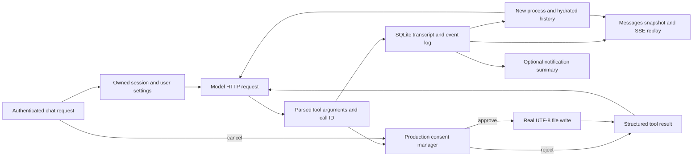

# Chat → tool → history → restart

This review traces the shipping gateway source into backend-selectable E2E scenarios.
The executable specification is [flows/chat.json](../flows/chat.json). Every source
reference has a unique anchor, and every mapped test belongs to the pinned migration
inventory. The migration runner rejects stale anchors and unknown test IDs and emits
`chat-flow.json` plus a source-linked Mermaid/coverage report beside each verdict.
This is a manually reviewed dependency map with executable observations, not a
whole-program static taint analysis or a claim of complete gateway coverage.

## Runtime path and evidence

The tests in [chat_flow.rs](../tests/chat_flow.rs) start `main({evaluation:true})`
through the standard owned-process fixture. The evaluation option suppresses
unrelated background maintenance/channel startup. Authentication, configuration,
SQLite migrations, HTTP routing, tool registry, consent, filesystem execution and
message/event persistence retain their production wiring. The model is a bounded
loopback HTTP/SSE peer written in Rust; no gateway function, tool or fetch export is
mocked. The same tests use the native executable when `--backend rust` is selected.
No Bun fixture fallback is permitted.

The source links below describe the production implementation; run-generated links
resolve current line numbers from anchors rather than relying on these review links.

| Boundary | Source | Data contract and observation |
| --- | --- | --- |
| Entrypoint and service composition | [main](../../../packages/gateway/src/index.ts#L156), [consent executor wiring](../../../packages/gateway/src/index.ts#L682) | Real service composition in an isolated home/state/project. Native health readiness alone does not provide these services. |
| Request and ownership | [chat route](../../../packages/gateway/src/routes/chat.ts#L3438), [HTTP auth](../../../packages/gateway/src/security/http-auth.ts#L95) | Bearer identity owns the session. Unauthenticated and foreign chat writes fail before any history or tool side effect. |
| Settings to provider | [LLM configuration](../../../packages/gateway/src/services/jait-llm.ts#L167) | An explicit local OpenAI-compatible backend instance and requested model reach the recorded HTTP request. The initial `openai` user setting can inherit the server's backend; the test therefore configures an explicit `omniroute` backend URL. No OmniRoute service is installed or required. |
| Model to tool | [tool event and execution](../../../packages/gateway/src/tools/agent-loop.ts#L1719), [ToolContext](../../../packages/gateway/src/routes/chat.ts#L3226) | `file_write` becomes `file.write`; arguments and call ID correlate with SSE, actual file bytes, persisted history and provider feedback. |
| Gateway consent | [executor](../../../packages/gateway/src/security/consent-executor.ts#L179), [decision HTTP routes](../../../packages/gateway/src/routes/consent.ts#L77), [ownership](../../../packages/gateway/src/security/control-access.ts) | Tests explicitly request `runtimeMode: supervised`. Omitted runtime mode defaults to full access. Owner approval authorizes execution; rejection does not write; a foreign user cannot approve or cancel. |
| File and feedback | [file.write](../../../packages/gateway/src/tools/file-tools.ts#L88), [registry validation](../../../packages/gateway/src/tools/registry.ts#L485) | CRLF, Unicode and literal shell characters remain exact UTF-8 bytes. Tool data may be enriched with page links by gateway routing; the entire observed result is compared between SSE, provider feedback and stored tool metadata. |
| Persistence | [message serialization](../../../packages/gateway/src/routes/chat.ts#L3175), [durable event log](../../../packages/gateway/src/routes/chat.ts#L2028) | User/assistant transcript, tool arguments and structured result survive restart. Durable event IDs strictly increase; `Last-Event-ID` replays the expected suffix unchanged. Messages and event rows are separate stores; these tests do not claim a single atomic transaction across them. |
| Recovery and next turn | [hydrateSession](../../../packages/gateway/src/routes/chat.ts#L3116), [snapshot](../../../packages/gateway/src/routes/chat.ts#L5772), [events](../../../packages/gateway/src/routes/chat.ts#L6049) | Completed transcript and cursor are stable across process death/relaunch; original user and assistant content enters the follow-up model request. Identical warm/cold tool-protocol reconstruction is still partial. |
| Cancellation | [cancel route](../../../packages/gateway/src/routes/chat.ts#L5458), [guard before tool execution](../../../packages/gateway/src/security/consent-executor.ts#L84) | Cancelling a pending consent turn reaches terminal output and clears active streaming; late approval cannot create the file. Implementations may invalidate the old consent or retain it behind an aborted-context guard. |
| Notification side branch | [notification generation](../../../packages/gateway/src/services/chat-notification.ts#L34) | After completion, the full entrypoint can issue an extra nonstream summary request. The peer recognizes and records up to two such requests separately; delivery, summary text and mobile/WS push are not asserted. |
| External CLI approval | [session approve route](../../../packages/gateway/src/routes/chat.ts#L5433) | This distinct route answers an ACP/CLI-provider approval. It is not the gateway consent endpoint exercised by the new scenarios and remains uncovered by this flow. |

## Scenarios

| Required ID under `chat_flow/` | Expected observable behavior |
| --- | --- |
| `approved_tool_data_survives_history_replay_restart_and_next_turn` | No preapproval file; exact bytes after approval; correlated successful result in provider feedback and persisted metadata; unchanged transcript, IDs and replay after restart; restored context reaches the next turn. |
| `rejected_tool_has_no_file_side_effect_and_reaches_provider_and_history` | Rejection produces structured failed tool feedback and history while leaving the file absent. |
| `foreign_user_cannot_approve_cancel_or_read_another_users_tool_flow` | Invalid/foreign chat, consent, cancel and transcript requests are denied; the pending owner request remains usable. |
| `cancellation_during_consent_prevents_late_approval_side_effects` | Cancellation terminates the turn and a later approval cannot execute the cancelled operation. |

Existing `active_stream` scenarios retain incremental UTF-8, replay/live handoff,
steering, cold/malformed cursors, finite slow-reader cancellation, provider/tool
failure, and interruption/restart coverage. The new scenarios add the production
consent and actual tool-effect boundaries rather than crediting those old scenarios
again.

## Proposed migration boundaries

1. Keep public request/auth/session routes and SSE event schemas compatible while
   replacing their implementation behind the same process contract.
2. Port the tool dispatch unit together: name/schema handling, ToolContext ownership,
   consent policy/decision, cancellation guard, concrete effect and structured result.
   Preserving a successful `tool_result` alone cannot establish that the right file
   was written or the provider received the result.
3. Port transcript and durable replay together: tool metadata serialization, message
   visibility, event-ID seeding, cursor replay and context hydration. Treat event IDs
   and call IDs as separate identifiers and preserve their correlation.
4. Compose these services in the shipping native entrypoint before claiming E2E
   parity. Standalone native helper tests and the Rust-owned Bun tests remain useful
   evidence for narrower boundaries.

## Validation and limits

Run `bun run test:gateway:migration --backend bun` and the same command with `rust`.
The required inventory contains 45 scenarios. The new `chat_flow` target is executed
against both backends, not short-circuited by the specialized stream-fixture block.
A 404/501 from its required public registration endpoint reports missing backend
implementation; later observed mismatches remain failures.

Four surgical negative controls were executed and restored: bypassed consent,
removed provider-feedback data, removed stored tool metadata, and corrupted
restart hydration. Every control made the unchanged happy-path E2E assertion fail;
the restored gateway passed. Control logs and source hashes are in
`.jait/artifacts/chat-flow-controls/report.json`.

Still outside this flow: browser UI lifecycle, full WebSocket/control-plane parity,
external CLI approval, notification delivery, historical released database formats,
complete warm/cold tool-protocol equivalence, arbitrary tool families and remote
nodes, sustained resource bounds, and Windows/macOS execution. Tests use a local
scripted peer and do not assess a real model's ability to choose tools. No native
implementation percentage is credited by this work.
